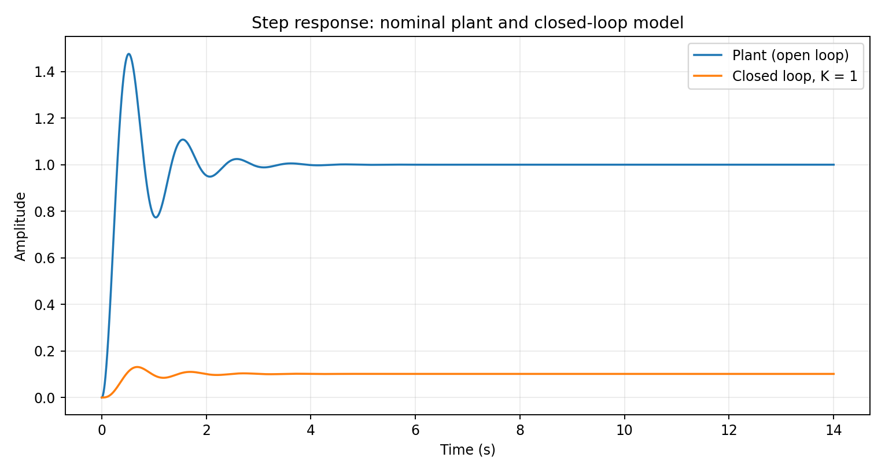
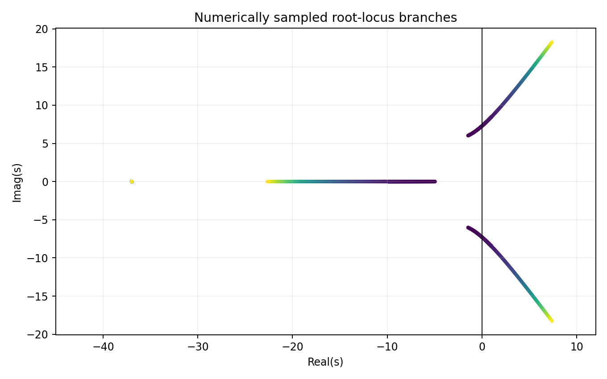
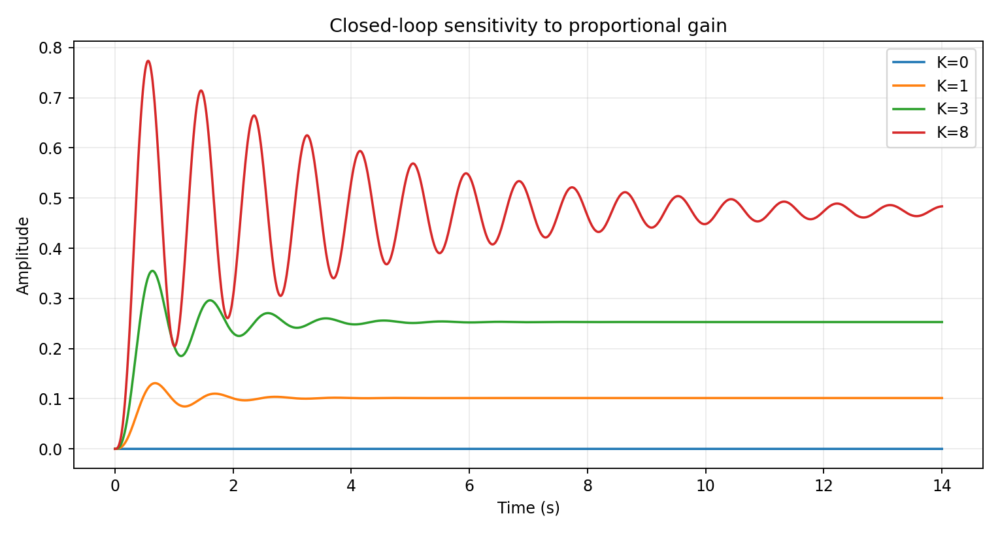
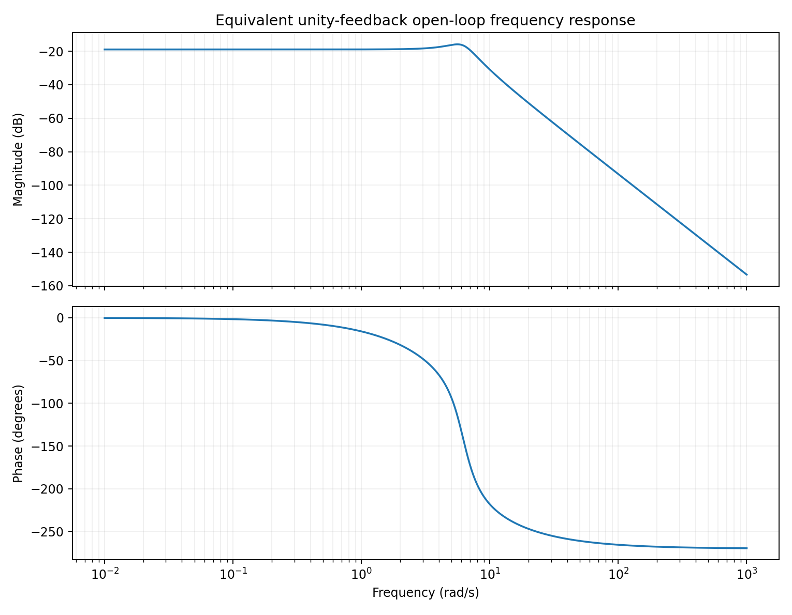

# Linear Control Systems — Comprehensive MATLAB Analysis

**Step response · feedback modeling · root locus · stability · Bode & Nyquist · model reduction**

A control engineering portfolio project based on a 17-question undergraduate *Linear Control Systems* assignment. It studies a student-specific second-order plant in an actuator-and-sensor feedback configuration. The original MATLAB work is preserved, with additional independently checked model derivation, more consistent reusable MATLAB scripts, numerical figures, and a transparent validation record.

> **Status:** Modeling and baseline analysis are documented. The archive also contains partial original scripts; completion of every design requirement (notably the time/frequency compensators in Q14–17) has not been demonstrated.

## Overview

For student-specific parameters `a = 23`, `b = 39`:

```math
P(s)=\frac{39}{s^2+2(0.23)\sqrt{39}s+39}
```

The feedback model includes actuator `A(s)=0.55/(s+5)` and sensor `H(s)=28.6/(s+37)` with negative feedback. See [full model derivation](docs/MODEL_DERIVATION.md).

## Numerical response comparison



*Independently recomputed using Python/SciPy from the assignment equations, rather than taken from archived MATLAB screenshots.*

## Root locus and gain sensitivity





## Frequency-domain analysis



The assignment also requested Nyquist analysis, Routh–Hurwitz reasoning, and design constraints; those are described as coursework tasks, not as validated new compensator results.

## Methods covered

| Theme | Evidence / deliverable |
|---|---|
| Plant response | Transfer-function representation and step-response metrics |
| Negative feedback | Derived fourth-order closed-loop transfer function |
| Equivalent unity feedback | Explicit mapping `T/(1-T)` for a standard root-locus setup |
| Stability and root locus | MATLAB study scripts and independent numerical visualization |
| Frequency response | Bode, gain/phase margin, Nyquist study script |
| Reduction | Candidate simplification and response-deviation check |
| Controller design | Assignment objectives recorded; no unverified final controller claims |

## MATLAB usage

Requires MATLAB and **Control System Toolbox**.

```matlab
run('matlab/01_step_analysis.m')
run('matlab/02_root_locus_and_stability.m')
run('matlab/03_frequency_response.m')
run('matlab/04_reduction_exploration.m')
run('matlab/05_gain_sweep.m')
```

The common system model is defined in `matlab/model_parameters.m`. Files under `archive/original-matlab/` retain the submitted script structure for comparison, including known inconsistencies.

## Reproducibility and tests

Python was used **only for independent numerical verification and portfolio figures**, not as a claim that the original coursework was developed in Python.

```bash
python -m pip install -r requirements.txt
python -m unittest discover -s tests -v
```

Read the [technical report (PDF)](docs/TECHNICAL_REPORT.pdf), the [editable report](docs/TECHNICAL_REPORT.md), and [validation notes](docs/VALIDATION.md) for checked results and unresolved tasks.

## Repository contents

```text
matlab/                  Reusable MATLAB analysis scripts
archive/original-matlab/ Archived original MATLAB submission
images/                  (within docs) Independently recomputed plots
docs/MODEL_DERIVATION.md Exact model derivation
docs/VALIDATION.md       Evidence and limitations
tests/                   Python numerical consistency checks
```

## Attribution and licensing

Expanded portfolio documentation and auxiliary checks were prepared separately. The instructor's assignment handout is not redistributed in this repository. No open-source license has been selected.
