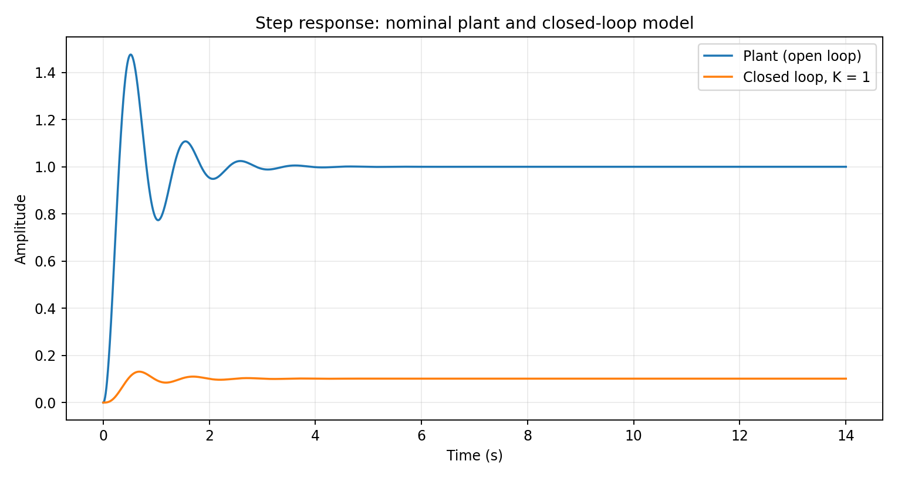
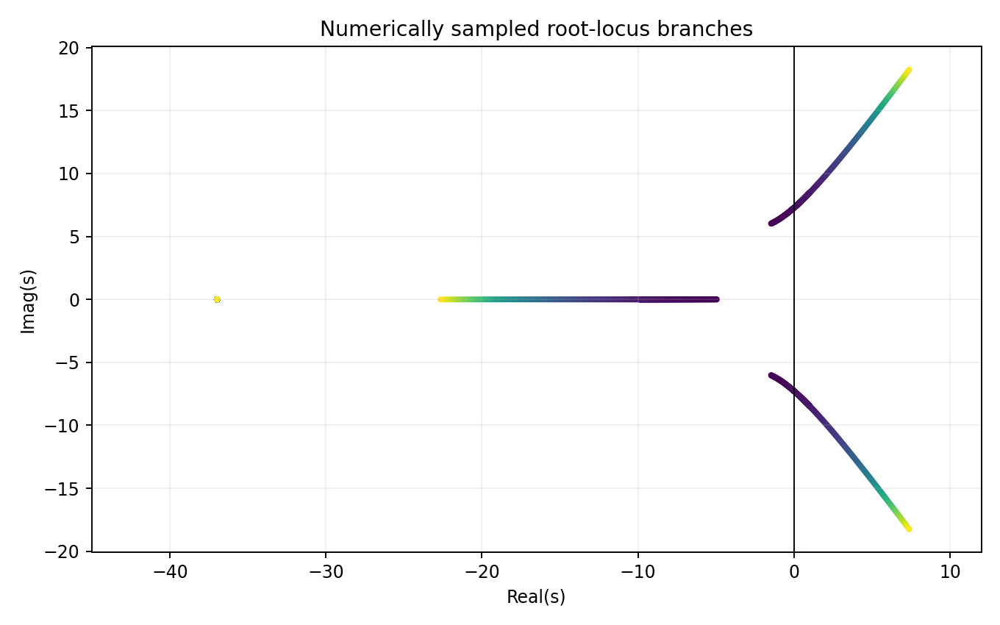
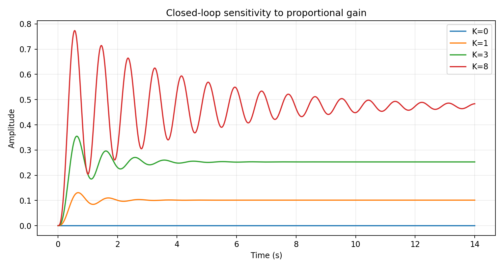
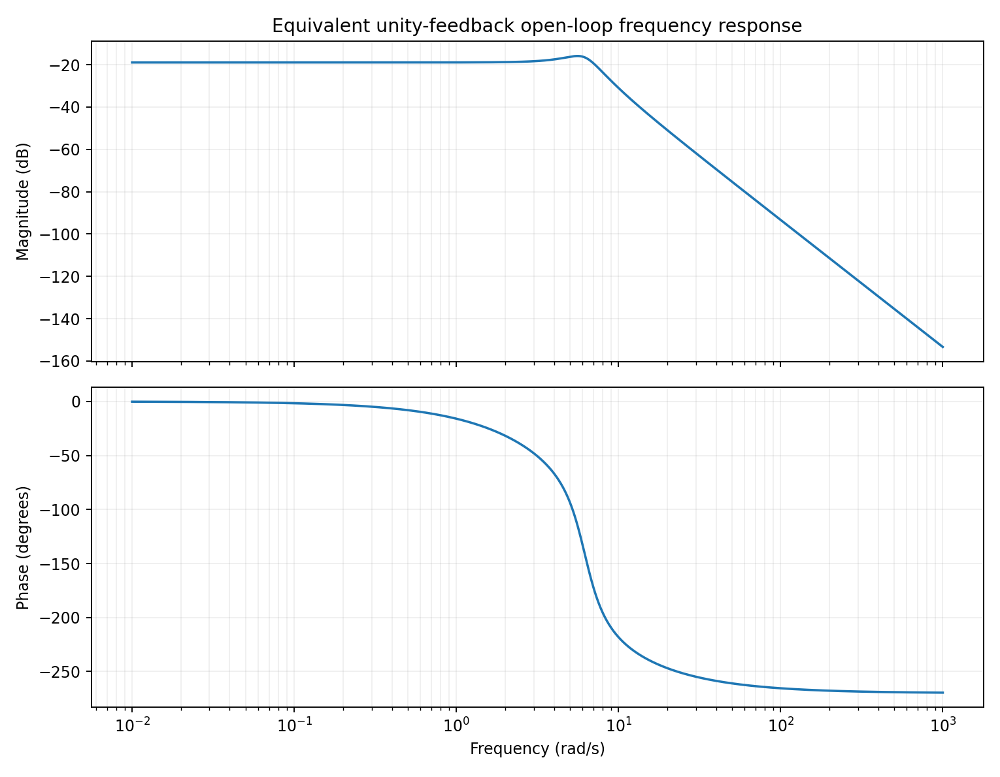

# Technical Study: Linear Control Systems Comprehensive Analysis

**Course:** Linear Control Systems  
**Original MATLAB coursework:** Hannane Ahmadi  
**Scope:** Transfer functions, feedback, transient responses, stability, root-locus and frequency-response analysis.

## 1. Abstract

A student-specific second-order plant is analyzed within a feedback system including a first-order actuator and a first-order sensor. The study derives the full fourth-order reference-to-output transfer function, distinguishes it from its equivalent unity-feedback open loop, and independently recomputes representative response and stability diagrams. The original scripts are preserved for provenance; refreshed MATLAB scripts improve consistency of the model. The report does not claim completion of controller-synthesis tasks without reproducible compensator design.

## 2. Problem definition and parameters

The original assignment determines its coefficients from the student number. For the submitted case, the digit sum is `a = 23`, and the final two digits are `b = 39`. Thus the nominal undamped natural frequency is `sqrt(39) = 6.245 rad/s` and damping ratio `zeta = 0.23`.

$$
P(s)=\frac{39}{s^2 + 2(0.23)\sqrt{39}s + 39}
$$

The actuator and sensor transfer functions are:

$$
A(s)=\frac{0.55}{s+5},\qquad H(s)=\frac{28.6}{s+37}.
$$

## 3. Feedback model derivation

With a unit-gain controller and negative feedback, the closed-loop transfer function is:

$$
T(s)=\frac{A(s)P(s)}{1+A(s)P(s)H(s)}.
$$

The numerator and denominator after expanding the full model are:

$$
T(s) \approx \frac{21.45s+793.65}{s^4+44.8727s^3+344.6534s^2+2169.4493s+7828.47}.
$$

The equivalent unity-feedback open-loop expression, `L_eq(s)=T(s)/(1-T(s))`, has denominator coefficients approximately `[1, 44.8727, 344.6534, 2147.9993, 7034.82]`. The different coefficients in archived files describe different loop representations and should not be substituted for one another.

## 4. Independently recomputed numerical observations

The source plant has unit DC gain and damping ratio 0.23, so its second-order response has a theoretical percentage overshoot of roughly 47.5% under the standard unit-step assumptions. The nominal closed loop has DC gain approximately **0.10138**, and an independent SciPy step-response calculation yields a peak overshoot of roughly **29.3%**, relative to that final value. These figures are auxiliary numerical calculations, not measured hardware outcomes.

The four closed-loop poles from the model are approximately `-36.9853`, `-5.3701`, and `-1.2587 +/- 6.1507j`. All have negative real parts, supporting nominal asymptotic stability for `K=1`.

## 5. Analysis workflow

- **Transient response:** compare the plant alone with the actuator/sensor feedback model. Different DC gains should be considered before comparing response amplitudes.
- **Root locus:** construct the equivalent unity-feedback loop and sweep a proportional gain, tracking the movement of the closed-loop poles.
- **Damping-ratio locus:** interpret `zeta = 0.5` using constant-damping rays in the left-half plane, not a line at `Re(s)=+0.5`.
- **Frequency response:** compute Bode and Nyquist diagrams on the intended open-loop function. Distinguish gain-crossover and phase-crossover frequencies.
- **Model reduction:** compare a candidate reduced representation against the original transfer function rather than relying only on coincident-looking poles and zeros.

## 6. Results and visual analysis

The following four figures were computed from the documented transfer-function model using Python/SciPy. They are independent numerical reconstructions, not screenshots from MATLAB or evidence that the full controller-design assignment was completed.

### 6.1 Step-response comparison

The nominal plant and feedback system have different steady-state gains, so response amplitudes should not be compared without noting the different scales.

{ width=88% }

### 6.2 Root-locus study

The figure samples closed-loop pole locations over a range of proportional feedback gains in the equivalent unity-feedback representation. It is an exploratory numerical locus, not an automatically optimized controller.

{ width=82% }

### 6.3 Gain sensitivity

The traces below show that transient and final-value characteristics depend on the proportional gain. They do not establish satisfaction of the assignment's controller-design specifications.

{ width=88% }

### 6.4 Frequency-domain analysis

The Bode magnitude and phase curves are evaluated for the equivalent open-loop transfer function used for classical stability analysis.

{ width=82% }

## 7. Source limitations and next steps

The archived `p4.m` resets the reduced model to the full-order expression before comparison, and the damping target logic in `p11.m` uses an incorrect right-half-plane line instead of a constant damping-ratio criterion. Other archival scripts mix a closed-loop denominator with an equivalent unity-feedback open-loop denominator. The reusable MATLAB scripts address the central consistency problems but have not been executed in MATLAB here.

Tasks 14 through 17 request time-domain compensator design and a 40-degree phase-margin / 2 rad/s crossover design. The archive does not contain verifiable complete solutions to those targets. These should be implemented and evaluated before they are presented as completed achievements.

## 8. Conclusion

The project demonstrates a broad undergraduate control-analysis workflow with substantial original MATLAB exploration. Its highest-value improvement is consistency: identify which transfer function each analysis uses, derive exact coefficients before plotting, and distinguish numerical reanalysis from submitted source evidence. Closed-loop controller design remains a legitimate extension rather than a claimed accomplished result.
